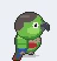

# Green-cheeked conure pet for Orca

A pixel-art green-cheeked conure for Orca's pet overlay, using the Codex pet sprite layout (96×104 frames, 9 animation rows; Orca scales them up pixel-perfect).

   

## Install

1. In Orca, click the pet in the status bar and choose **Import .codex-pet bundle…**
2. Pick `green-cheek-conure/spritesheet.webp` (or the `green-cheek-conure` folder). Orca reads the `pet.json` beside it.
3. If Orca asks, quit and reopen the app.

## Animations

Every state is a calm 8 s loop at the timing of Orca's built-in Claudino pet (96 frames at about 12 fps). Movement stays within a pixel or two, and each state has one soft symbol that fades in and out.

| State | What it does |
|---|---|
| `idle` | Sits still, blinks, a slow head tilt |
| `running` (agent working) | Two short sung phrases with a soft nod and a rising note |
| `running-left` / `running-right` (dragging) | A soft 1 s walk, stepping foot to foot |
| `waving` | A slow wing wave with a heart |
| `jumping` | One small pleased hop, then a sparkle |
| `failed` | Droopy eyes, a sigh, one slow sweat drop |
| `waiting` (needs input) | A slow curious head tilt with a "?" |
| `review` | Leans in and squints, then a content smile and a sparkle |

Every frame: [`preview/contact.png`](preview/contact.png).

## Regenerate

The sprite is drawn in code at 48×52 pixels and scaled 2×.

```sh
pip install pillow
python make_conure.py green-cheek-conure
```

Edit the palette, the part shapes in `bird()`, or the frame lists in `ANIMS`, then re-import the bundle in Orca.
