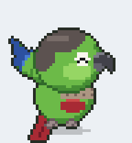
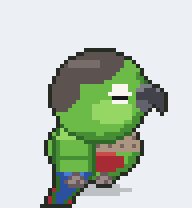

# Green-cheeked conure pet for Orca

A pixel-art green-cheeked conure for Orca's pet overlay, using the Codex pet sprite layout (96×104 frames, 9 animation rows; Orca scales them up pixel-perfect).

   

## Install

1. In Orca, click the pet in the status bar and choose **Import .codex-pet bundle…**
2. Pick `green-cheek-conure/spritesheet.webp` (or the `green-cheek-conure` folder). Orca reads the `pet.json` beside it.
3. If Orca asks, quit and reopen the app.

## Animations

| State | What it does |
|---|---|
| `idle` | Breathes, blinks, tilts its head |
| `running` (agent working) | Calm 8 s loop, 96 frames at ~12 fps like the built-in Claudino: two short sung phrases with a soft nod and a fading note |
| `running-left` / `running-right` (dragging) | Hops with fluttering wings |
| `waving` | Waves a wing, with hearts |
| `jumping` | Jumps with both wings spread, sparkles |
| `waiting` (needs input) | Tilts its head and taps a foot, with a "?" |
| `failed` | "!", dizzy eyes, then droops with a sweat drop |
| `review` | Leans in and squints, then sparkles |

Every frame: [`preview/contact.png`](preview/contact.png).

## Regenerate

The sprite is drawn in code at 48×52 pixels and scaled 2×.

```sh
pip install pillow
python make_conure.py green-cheek-conure
```

Edit the palette, the part shapes in `bird()`, or the frame lists in `ANIMS`, then re-import the bundle in Orca.
